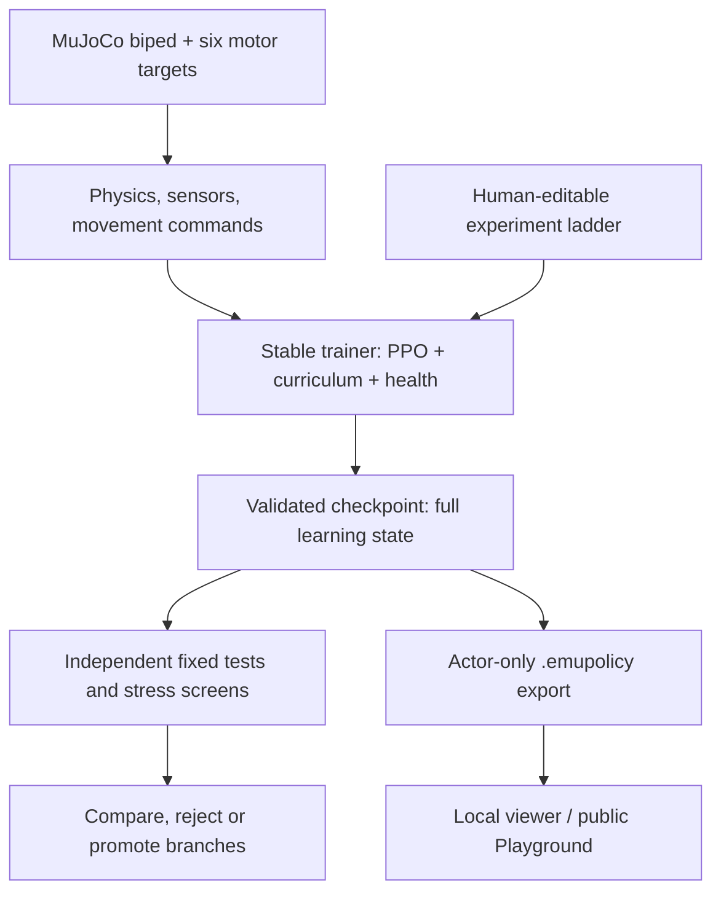

# EMU — a small robot learning to walk

**Six actuators, two feet, and no scripted walking animation.** EMU is an experimental biped trained with reinforcement learning to step, steer, and recover balance in MuJoCo physics.

**[Continue work: HANDOVER.md](HANDOVER.md)** · **[Try the public EMU Playground](https://mdt733.github.io/emu/)** · [Start here: how EMU works](docs/architecture.md) · [Simplification roadmap](docs/SIMPLIFICATION.md) · [Install](docs/INSTALL.md) · [Project status](docs/STATUS.md)

The public Playground runs a previously trained **60-million-step policy** in your browser using MuJoCo WebAssembly and a JavaScript neural-network interpreter. It does not train a robot, and looking good in the viewer is not proof of held-out performance.

## The idea in one paragraph

EMU has **a robot and a universe**, **a reward** that judges each control step,
**PPO** that learns, **a curriculum** that decides what to practise next, and
**an experiment recipe** that compares entire teaching strategies. Independent
**reports** explain what worked; the **viewer** lets you inspect a frozen
brain. The [architecture](docs/architecture.md) is our primary explanation,
including gaps in the current code. The [living checklist](docs/SIMPLIFICATION.md)
prevents the next refactor passes from drifting off course.

## The project in one picture



The actor receives **55 deployable observations over four frames (220 inputs)** and produces **six motor commands**. The simulator, curriculum, capability field and evaluators have separate responsibilities. The browser runs a frozen policy; it does not alter checkpoints.

## Start here

Requires **Python 3.13+**, Git and **Node.js 24** on Linux/WSL2. GPU training additionally requires a compatible NVIDIA/JAX CUDA setup. A normal clone can explore the code and run CPU contract tests without a GPU.

```bash
git clone https://github.com/mdt733/emu.git
cd emu
bash scripts/setup_wsl.sh --install-node
source .venv/bin/activate
emu doctor --no-require-gpu --no-mjx-smoke
emu ladder --stage plan
bash scripts/check.sh         # all 20 essential checks
```

To train on a configured GPU, finish the CUDA installation and run the real MJX/PPO smoke test first:

```bash
emu doctor --v5015-smoke --domain-smoke
bash scripts/run_ladder.sh
```

**Never change the source commit, ladder recipe or training configuration during an active run.** Run outputs and large checkpoints belong outside Git, normally under `~/robot_lab/emu_runs/`. The launcher verifies the local source, compiles a real PPO update and refuses to begin if the GPU smoke fails. See the [installation guide](docs/INSTALL.md) and [validation gates](docs/validation.md) before spending GPU time.

To watch *completed, validated* checkpoints separately:

```bash
emu viewer --live --root ~/robot_lab/emu_runs/v5015_lab1 --no-open
```

Then open `http://127.0.0.1:8765/` on that computer. This loopback-only server is **not authenticated**; do not publish or port-forward it.

## Where the code lives

| Area | Authoritative source | Responsibility |
|---|---|---|
| Robot and physics | [`emu/robot.xml`](emu/robot.xml), [`emu/environment.py`](emu/environment.py) | Bodies, contacts, sensors, rewards, resets |
| Learning engine | [`emu/training.py`](emu/training.py), [`emu/ppo.py`](emu/ppo.py) | PPO updates, rollout processing, health/evaluation schedule |
| Configurable experiments | [`emu/ladder_recipe.py`](emu/ladder_recipe.py), [`emu/branch_lab.py`](emu/branch_lab.py) | Step targets, hypothesis arms, checkpoints, promotion |
| State and safety | [`emu/training_config.py`](emu/training_config.py), [`emu/checkpoint_io.py`](emu/checkpoint_io.py) | Validated knobs, schema, atomic publication |
| Independent evaluation | [`emu/evaluation.py`](emu/evaluation.py), [`emu/screening.py`](emu/screening.py) | Fixed questions, matched branch comparisons |
| Browser | [`emu/viewer_src/`](emu/viewer_src/) | Canonical JavaScript inference and MuJoCo/Three.js UI |

`emu/viewer_src/` is the **only** tracked viewer source; no generated mirror needs synchronising. Retired `forge` and `tournament` recipes remain available through Git history rather than as competing current runners.

## What the evidence does — and doesn't — say

- The **public 60M champion** is protected from automatic replacement. Publishing viewer changes is a separate, manual GitHub Pages action.
- A v5015 foundation **completed 20,054,016 environment steps**, but the first ladder stopped because the trainer and runner disagreed about its output directory. The draft fix is covered by CPU regression tests; a complete resumed GPU experiment has **not** been demonstrated yet.
- The draft tinyEmu experiment recipe is a **20M shared foundation plus four independently continued 80M policies** (60M additional steps each; **260M aggregate through the four-way screen**). Optional finalists reach 100M and 120M. See [the isolated WSL GPU campaign runbook](docs/TINYEMU_GPU_CAMPAIGN.md). The new branch still requires its own GPU acceptance and the score alone does not establish walking quality.
- Training rewards, self-assessed capability nodes and attractive viewer motion are **not** interchangeable with independently measured locomotion. The current screening gates also need calibration against genuine stepping and command tracking evidence.

For precise acceptance criteria and limitations, read [Project status](docs/STATUS.md), [Evaluation](docs/evaluation.md), [Training](docs/training.md) and [Validation](docs/validation.md).

## Contributing

Run `bash scripts/check.sh` before proposing changes. [The 20-check guide](docs/TESTING.md) explains what these checks prove and why actual GPU walking evaluations remain separate. Changes to PPO, robot physics, actor observation ordering or checkpoint format require additional GPU checks. See [CONTRIBUTING.md](CONTRIBUTING.md) for review expectations and [docs/README.md](docs/README.md) for the document index.

EMU is a research project, not a verified hardware controller. Its aim is measurable *dynamic walking*, not a robot that discovers standing still is the easiest way to survive.
