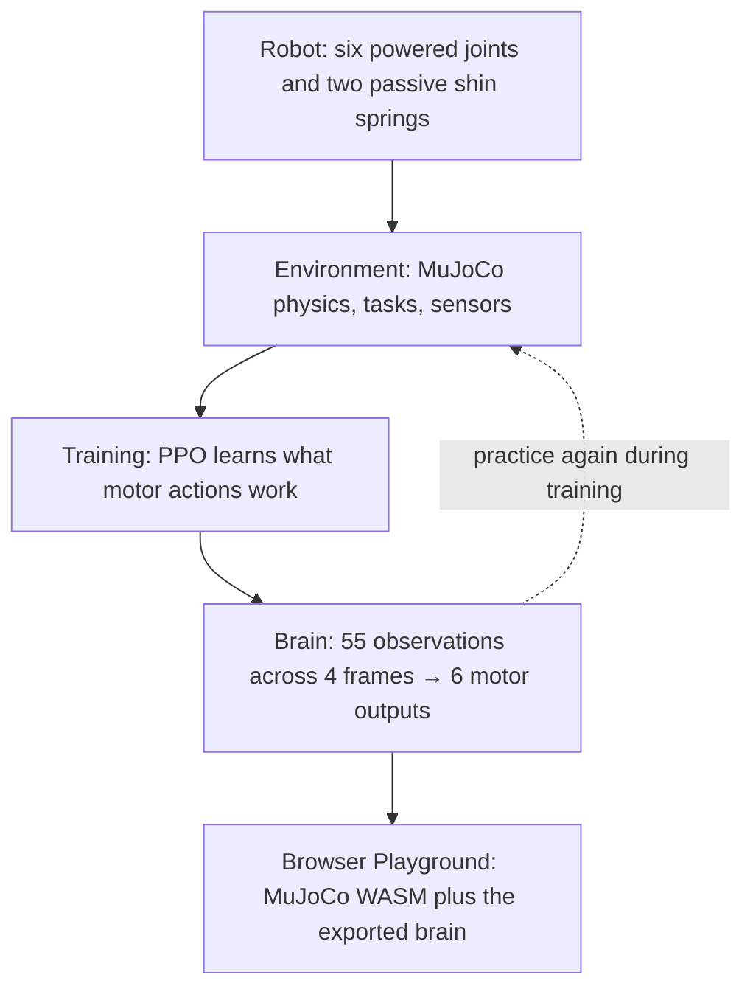

# EMU — a little robot learning to walk

**Six motors. Two feet. No prewritten walking animation.** EMU is an open-source biped learning to step, steer, catch itself and recover balance in simulated physics.

## [▶ Try the EMU Playground](https://mdt733.github.io/emu/)

**[Open the live browser demo](https://mdt733.github.io/emu/)** · [Source code](https://github.com/mdt733/emu) · [How it works](docs/architecture.md)

The Playground runs a published **60-million-step policy** in your browser. Move using the left joystick, turn and command chassis pitch with the right, or let the demo select commands. The new **View** button cycles orbit view, raw chassis POV, and visually levelled POV.

> This is a learning experiment, not an animation or a finished physical robot. The public demo is not a held-out scientific evaluation, and the next v5015 training experiment has not yet begun.

## How it works



The robot receives movement and posture requests. It senses gravity-relative orientation, motion, joints and foot locations, then chooses six motor targets 50 times per second. Training shapes its neural network through simulated experience; **the exported browser brain does not keep learning**.

**Two important angles:** *Robot lean* describes the line from the midpoint between the feet to the centre of the chassis relative to vertical; *chassis pitch* describes the actual body/IMU angle relative to gravity. They are different. [See the definitions and explanation](docs/architecture.md#robot-lean-vs-chassis-pitch).

### Explore the world

Orbit view makes gait easy to watch. **Raw POV** follows the chassis camera, shake included. **Level POV** smooths the picture without helping the robot balance. The optional **physical 1° ramp** under Settings adds real MuJoCo collision geometry in the *browser only*: unlike the flat-floor baseline, it is an experimental obstacle, **not yet a verified champion capability**. [Playground guide](docs/PLAYGROUND.md).

## The code, without the mystery

| Part | Start with | Purpose |
|---|---|---|
| Robot | [`emu/robot.xml`](emu/robot.xml) | Body, masses, joints, motors and contacts |
| Environment | [`emu/environment.py`](emu/environment.py) | Physics tasks, observations, reward and resets |
| Training | [`emu/training.py`](emu/training.py) + [`emu/production.py`](emu/production.py) | PPO learning loop and 20/60/140/260/400M training phases |
| Brain | [`emu/ppo.py`](emu/ppo.py) | Neural actor/critic and optimiser |
| Viewer | [`viewer/`](viewer/) | Canonical JavaScript source for MuJoCo WASM, controls and cameras |

The other Python modules handle curriculum, domain randomisation, checkpoint safety and evidence. Tests and selected results are intentional, not clutter. `emu/viewer_src/` remains a **generated packaging mirror**, not a second editable viewer. Large training runs and raw checkpoints live outside Git.

## v5015 development

The **60M public champion remains the protected baseline**. The operator stopped the v5014 400M attempt after noticing the robot progressively crouch. This might be a training incentive problem, but the cause is not yet established.

The v5015 draft adds an optional POV and real browser ramp prototype, separates robot lean from chassis pitch in telemetry, and introduces a **read-only height history finder** plus a signed measured-minus-commanded height metric for *new* training runs. No new policy has been trained yet.

```bash
emu posture-report                         # scan ~/robot_lab/emu_runs/metrics.csv histories
emu posture-report --root /path/to/run      # search a selected run
```

Next we will verify the ramp and POV, diagnose crouch using any surviving run data, then carefully adjust training, evaluation and the ±45° pitch envelope.

## Running EMU yourself

For a fresh Linux/WSL2 checkout you need Python 3.13, Git and Node.js 24. GPU training requires compatible NVIDIA/JAX CUDA support.

```bash
bash scripts/setup_wsl.sh --cuda13 --install-node  # omit --cuda13 for CPU-only work
source .venv/bin/activate
emu doctor --domain-smoke
emu forge --plan  # inspect the phases without starting training
```

`emu viewer --live --no-open` starts a separate read-only **local** checkpoint viewer at http://127.0.0.1:8765/. The public Playground is static and never accesses your private training run.

**Details when you're ready:** [Install](docs/INSTALL.md) · [Architecture](docs/architecture.md) · [Training](docs/v5014-production.md) · [Evaluation](docs/evaluation.md) · [Document index](docs/README.md) · [History](docs/history.md) · [Current handover](HANDOVER.md) · [Validation evidence](RELEASE_VALIDATION.md).
