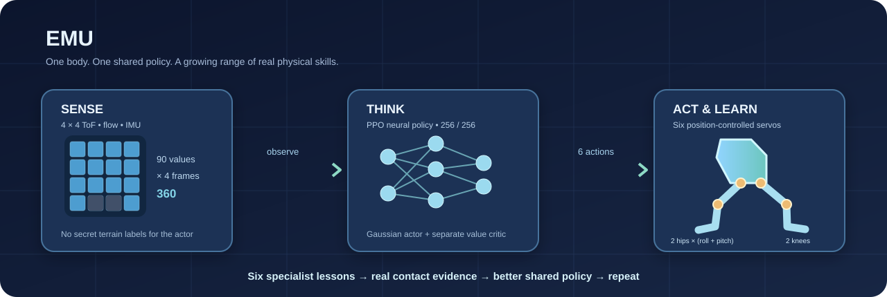

# EMU — learning to walk, recover and negotiate the world

**One dynamically unstable, six-servo biped. One neural policy. One physical learning curriculum.**



EMU learns to balance and move using reinforcement learning in MuJoCo/MJX. It has no hand-authored sequence of footsteps: a single policy learns how to coordinate six actuators in response to motion commands, inertial and leg feedback, and a simulated forward-looking depth array.

[Try the public playground](https://mdt733.github.io/emu/) ·
[Install / operate](docs/INSTALL.md) ·
[Learning architecture](docs/UNIFIED_CAPABILITY_GROWTH.md) ·
[Research status](HANDOVER.md) ·
[Documentation](docs/README.md)

## Two realities: published robot and research robot

| | Published Pinnacle (`main`) | Research successor (`feature/v5031-verified-ascent`) |
|---|---|---|
| Status | Protected reference and live browser demo | Experimental; **not released** |
| Observation contract | 232-input sensor policy | 360-input terrain-array policy |
| Actions | Six servo targets | Six servo targets |
| Research focus | Proven dynamic gait and high command envelope | Retain fast, confident walking **and** learn supported slopes, steps, resilience and energy-aware control |
| Policy replacement | None without owner approval | Must first beat the incumbent on independent **common physical tests** |

The predecessor's roughly **1 m/s requested forward command envelope** is an important target to regain. A large requested speed is **not** evidence of accurate measured speed: the comparison must record actual forward velocity, command error, falls, headings and mechanical effort at the same physical task. The new policy must not improve steps by becoming a permanently slow or timid walker.

**Nothing on an experimental branch replaces the public policy automatically.**
A candidate is promoted only after reproducible evaluation, review and explicit approval.

## What the robot learns

EMU uses one shared PPO actor/optimizer across six complementary teaching emphases, not six different brains.

| Teaching emphasis | What success actually means |
|---|---|
| **Commands** | Accurate forward, reverse, lateral and yaw requests across an expanding speed envelope |
| **Slopes** | Supported uphill/downhill/camber motion **and** accurate commanded progress |
| **Steps** | Genuine supported step **up and down**, separated by direction, height and approach |
| **Resilience** | Recover from measured disturbances and retain earlier competence |
| **Transitions** | Respond to changing commands without unstable overshoot or falls |
| **Control / efficiency** | Smooth, useful movement with bounded actuator effort and slip |

Every emphasis still rehearses other capabilities at easier difficulties. Frontiers are expanded based on observed physical outcomes, not simply elapsed steps. Harder practice is not a certificate of mastery.

### Real steps, not a decorative terrain label

The terrain course has physically colliding support surfaces, adjustable incline and an elevated/depressed step. A real crossing requires supported contact on the far side, not just surviving near the obstacle.

The 360-input policy receives simulated delayed/noisy measurements, including the forward **4×4 ToF array**. Privileged simulator coordinates may be used by the *teacher* to verify success, but do not become deployable neural inputs.

We score at least four different outcomes separately: physical crossing, mission/velocity tracking, heading/path retention, and safe recovery. A step **down** does not count as a step **up**.

## Current research — v5031 verified support transfer (31 October 2026)

The 360-input research successor is not yet a replacement for the
published `main` policy. The [fresh installation and
GPU acceptance guide](docs/INSTALL.md) covers Windows/WSL2, Python 3.13,
JAX CUDA 13, Node 24, pytest, and a source-isolated new checkout.

The v5030 temporal-reward study compared a normal per-frame forward-speed
reward against a 25-frame (0.5 s) blended reward. At 80M, the temporal
reward arm B had the better broad fixed score (0.7587 vs 0.7453).
B is the **research baseline**, not a public release.

In matched real-geometry physical exams B80 sustained 0.6 m/s requests
in 15/16 worlds (mean achieved 0.541 m/s) and 0.8 m/s in 10/16,
but a requested 1.0 m/s was not sustained. It climbed a real 2 cm
step up in 8/8 cases, 2.5 cm in 3/8, and 3 cm in 0/8. At 3 cm it
largely *stalled* instead of falling, which guides the next lesson.

The source-pinned [v5031 experiment](docs/V5031_VERIFIED_ASCENT.md)
forks both arms from the **same v5030 B80 checkpoint** at 80,019,456
steps, and continues to 100M with and without **reallocation of 3
existing ascent-shaping reward points** to verified foot contact plus
actual supported height transfer. It does not add free reward, hide a
command change, or suppress normal stride-related yaw oscillation.
The experiment must clear CPU tests and full 2048-world CUDA preflights
before training; outcomes are not yet established.

**Source safety:** frozen training branch
`feature/v5031-verified-ascent`, SHA
`93cb5cf5a541416ab4366140b2205aca6bfb89a7`.
An implementation/docs fix goes onto a separate branch, never into
the experiment's running checkout. Current v5031 is a **checkpoint
continuation**, not a new-machine cold-start launcher: new systems
need the backed-up B80 policy or must reproduce the earlier cold-start
lineage at its source SHA. See [the handover](HANDOVER.md) for details.

### Completed studies

The [v5028 considered-steps study](docs/V5028_CONSIDERED_STEPS.md)
established reliable 2 cm supported upsteps and occasional 2.5 cm
upsteps but exposed slow-speed specialist dominance. The
[v5029 speed-restoration audit](docs/V5028_SPEED_FRONTIER_AUDIT.md)
led to long 32 m physical support slabs and real fast-gait rehearsal.
The [v5030 reward study](docs/V5030_REWARD_EXPERIMENTS.md)
then established the temporal-forward-tracking research baseline.
All previous trained checkpoints and the protected published
champion are retained. Past launch instructions are historical
and should be read only with their recorded Git commits.

## Reading training results without fooling ourselves

The console reports time, rollout/reward, fall rate, throughput, command envelopes, terrain exposure and actuator-effort proxies. These are useful telemetry, but **curriculum difficulty is not measured proficiency**.

The key independent outcomes are:
- **Speed:** actual signed velocity and command tracking, including up to the ~1 m/s target.
- **Terrain:** supported UP/DOWN crossings at each exact height; true four-bearing slope missions.
- **Safety:** falls, slip, supported settlement, retreat/braking distance and recoverability.
- **Control:** sideways/yaw accuracy, smoothness, and shaft-work per useful metre.
- **Retention:** do all of those remain competent on easy known tests when harder skills grow?

The current training experiment does **not** implement reliable ToF-conditioned navigation refusal. That separate future milestone is described in [traversability and safe refusal](docs/TRAVERSABILITY_REFUSAL.md).

## Project map

```text
emu/
  environment.py       physical MJX worlds, sensor readouts, command trim, teacher outcomes
  rewards.py           PPO teaching payments
  curriculum.py        active difficulty and teaching governor
  capability_field.py  learned command/recovery competence evidence
  capability_cloud.py  read-only held-out command/recovery probes
  capability_focus.py  six teacher roles and episode allocations
  ppo.py               single shared policy, value model and optimiser
  training.py          rollouts, fixed evaluations, logging and checkpoints
  training_config.py   validated learning settings
  run.py, cli.py       guarded run/export/exam entrypoints
  evaluation.py        fixed-eval, capability atlas and stable exam entrypoints
  physical_exam.py     independent headed motion, steps, slopes and recovery
  viewer_src/          browser simulation and playground
scripts/
  v5031_verified_ascent_ab.py   B80→100M pinned matched ascent reward continuation
  v5030_temporal_reward_ab.py   completed reward A/B reproducibility
  smoke_unified_focus.py       CPU / CUDA physics + PPO preflight
  setup_wsl.sh                 fresh WSL install and browser build
  smoke_training_lifecycle.py
docs/
  README.md            current documentation index
  history/             source-pinned historical findings (not live recipes)
showcase/
  champion.emupolicy   protected, publicly approved Pinnacle
```

**Recommended entry points:** [Installation](docs/INSTALL.md), [physical capability inventory](docs/CAPABILITY_DIMENSIONS.md), [research handover](HANDOVER.md), [playground](docs/PLAYGROUND.md), and [release gates](docs/RELEASE_READINESS.md).

## Contributing and release discipline

Every behavioural experiment uses a **new feature branch** and an exact source SHA. Running branches and checkpoint lineages are never silently modified. Prefer simplifying or replacing old machinery when a new approach is proven; do not accumulate multiple overlapping "current" systems. Keep evidence and the commands that generated it in research history, not in the quick-start guide.

A beautiful merge is not just smaller code: it is **one legible implementation**, a believable physical comparison against `main`, reviewable provenance, clean docs and a working playground. The original champion stays protected until that standard is reached.

[Engineering maintenance rules](docs/MAINTENANCE.md) · [Graduation checklist](docs/RELEASE_READINESS.md)
