# EMU — teaching a six-servo robot to walk, recover and explore

**One dynamically unstable biped · one policy · 2,048 parallel physics worlds · six specialist lesson families**


> **The big idea:** EMU is not programmed with a walking gait. It learns a useful, dynamically balanced gait through physical simulation and reinforcement learning. Once it can walk, different groups of simulated environments teach it to move faster, catch itself, negotiate slopes and steps, change direction, and waste less effort—**without forgetting what it already knew**.
>
> This document describes the **actual code on `feature/v5024-release-polish`**, including the recovery-first v5026 experiment. Experimental goals, teacher targets and measured performance are distinguished throughout.

[Try the public playground](https://mdt733.github.io/emu/) ·
[Install & run](docs/INSTALL.md) ·
[Recovery-first research plan](docs/RECOVERY_FIRST_GROWTH.md) ·
[Technical learning design](docs/UNIFIED_CAPABILITY_GROWTH.md) ·
[Physical dimensions](docs/CAPABILITY_DIMENSIONS.md) ·
[Latest handover](HANDOVER.md) ·
[Documentation index](docs/README.md)

---

## The whole project in one minute

Imagine trying to teach a tiny, top-heavy person to walk. You cannot simply make it stand still: EMU's mechanics require **continuous correction, foot placement and dynamic recovery**. Nor can you hand it a prerecorded animation and call that intelligence.

EMU starts with random neural-network weights, acts in a simulated robot, experiences what happens, and adjusts its policy to prefer physical outcomes that are genuinely useful.

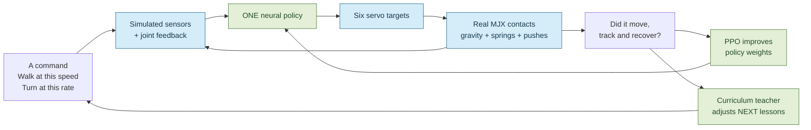

**Three different jobs, often confused:**

| Component | Plain-English job | What it is *not* |
| --- | --- | --- |
| **Robot / world** | Calculates real simulated motion, collision, sensors and failures | A scripted gait or prerecorded animation |
| **PPO learner** | Changes neural-network weights based on rewards and experience | The teacher that picks slopes, speeds or step heights |
| **Curriculum teacher** | Decides the distribution of tomorrow's physical lessons | An extra neural controller or a certificate of mastery |
| **Independent examiner** | Replays fixed physical challenges to measure actual competence | A reward bonus or a direct PPO teaching signal |

Every specialist contributes gradients to **the same policy**. At inference time there is one network and one set of six motor actions.

### What are we building?

We want to expand the set of conditions where the robot can **move as commanded**, remain supported, recover from disturbances and expend reasonable effort. Simply surviving, drifting downhill, or showing an impressive training frontier is insufficient.

That distinction is the centre of the new **recovery-first** experiments: a robot may fall at a newly attempted 0.8 m/s, but it should not forget reliable recovery at 0.2 m/s just because it is learning to go faster.

---

## 1. The physical EMU

EMU has **six driven joints**: one hip roll, one hip pitch and one knee on each leg. Additional compliant elements (including passive shin flexion) are simulated; these are **not extra actuators**.

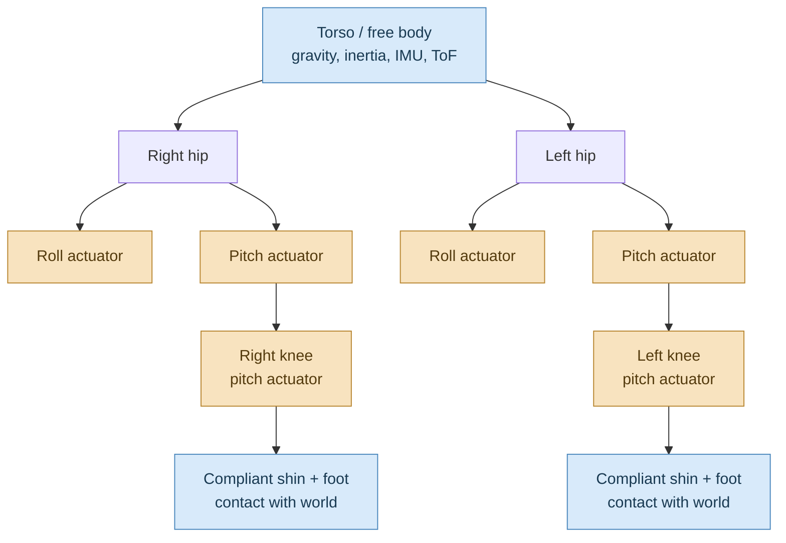

The policy does **not** choose where each foot must go. It produces **six continuous action values in [−1, +1]**. These become joint-position requests around the robot's neutral pose, with mechanical bounds. The simulated servos receive the **previous control frame's target** (one control-frame command delay), then MuJoCo handles the actual motion.

| Physical clock | Value | Why it matters |
| --- | ---: | --- |
| Physics timestep | **5 ms** (200 Hz) | Gravity, collisions and servo response |
| Physics steps per action | **4** | Actions aren't injected at each microscopic physics step |
| Policy/control timestep | **20 ms** (50 Hz) | New observation → six new requests |
| Max episode duration | **700 control frames / 14 s** | Reset after fall or time limit |
| Parallel training worlds | **2,048** | Thousands of different experiences per PPO update |

The world includes gravity, body and foot contacts, actuators, compliant springs, finite collision surfaces, inclines, step discontinuities and random external forces. Its physical parameters and terrain are **simulation inputs**, not magical knowledge fed to the policy.

**Energy caveat:** `shaft≈J/m` comes from simulated actuator torque × angular velocity divided by useful distance. Spring potential energy is tracked separately. Neither is a battery-power measurement.

**Code:** [robot model](emu/robot.xml) · [simulation and contact maths](emu/environment.py) · [constants](emu/contracts.py)

---

## 2. How EMU experiences the world: the 360-input actor

A person can see a curb and instinctively lift a foot. The policy only knows what comes through its **sensor and proprioception observation contract**.

The new observation consists of **90 values per frame × four recent frames = 360 scalar inputs**.

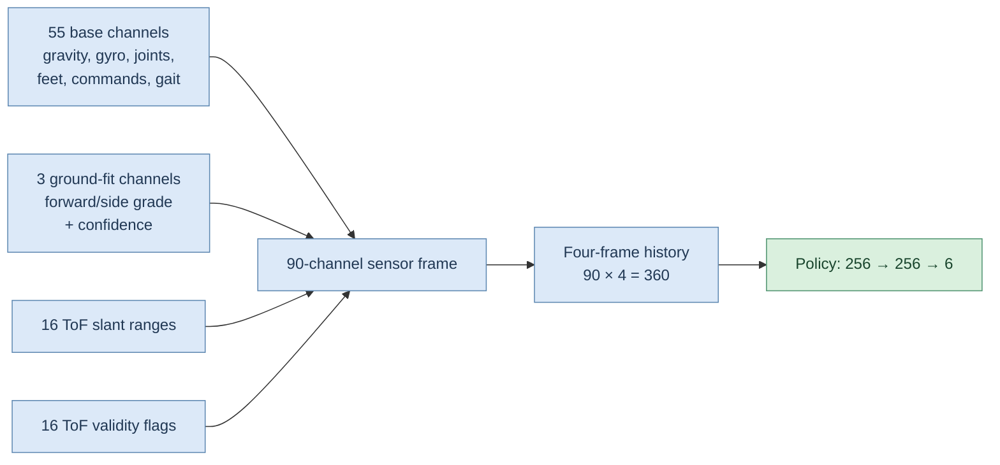

| Sensor group | Channels per frame | What it tells the robot |
| --- | ---: | --- |
| Base proprioception and commands | 55 | Body-relative gravity/rotation, 6 joint angles, 6 joint speeds, previous actions/controls, feet, estimated movement, operator requests, gait phase and shin behaviour |
| Fitted terrain estimate | 3 | Ahead-of-robot grade, sideways grade, visibility confidence |
| Forward 4×4 ToF depth array | 16 | Distances returned by physical ray/ground intersections |
| 4×4 validity flags | 16 | Which depth cells contain credible readings |
| **Total** | **90** | **Four frames → 360 policy inputs** |

### The forward ground sensor

The virtual time-of-flight array is at the torso (no forward mounting offset). Its ray fan is angled downward about **70°**, spanning four pitch rows and four yaw columns.

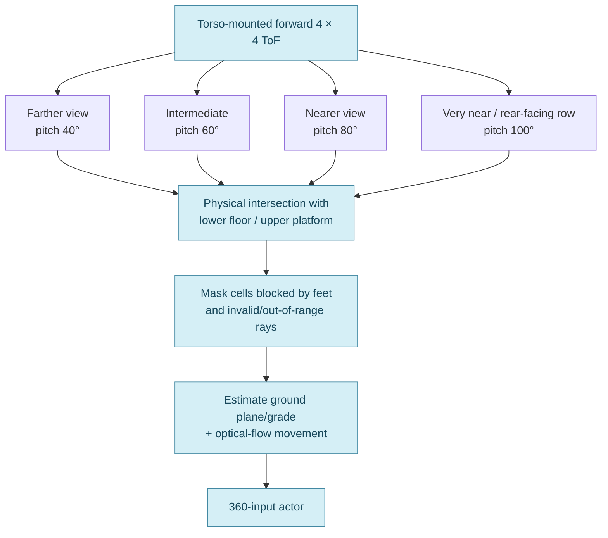

Each cell has both a range and a validity bit. Foot occlusion, finite range, sensor timing, one-frame delays, noise and dropout matter. Optical flow and IMU readings are synthesised from world physics, but the policy gets their **estimated measurements**, not privileged true position, exact grade or collision-object IDs.

A subtle but important detail: the **reward and examiner** may use ground-truth velocities and contacts to score learning. The **actor** does not get these teacher-only facts merely because they exist in the simulator.

**Code:** [observation schema](emu/contracts.py) · [sensor geometry, delays and inversion](emu/environment.py) · [normalisation](emu/ppo.py)

---

## 3. PPO: how random actions become useful walking

EMU uses **Proximal Policy Optimization (PPO)**, an on-policy policy-gradient algorithm. In everyday terms:

1. Observe each robot's state and sample a motor action from the actor's Gaussian output.
2. Advance the real MJX physics and calculate a reward for what happened.
3. Repeat for a short rollout across all worlds.
4. Use a separate **value network** to estimate how much future reward each state is worth.
5. Compute which actions turned out better or worse than expected (advantages).
6. Update the networks carefully, without making one giant destabilising jump.
7. Gather **fresh** experience under the changed policy and repeat.

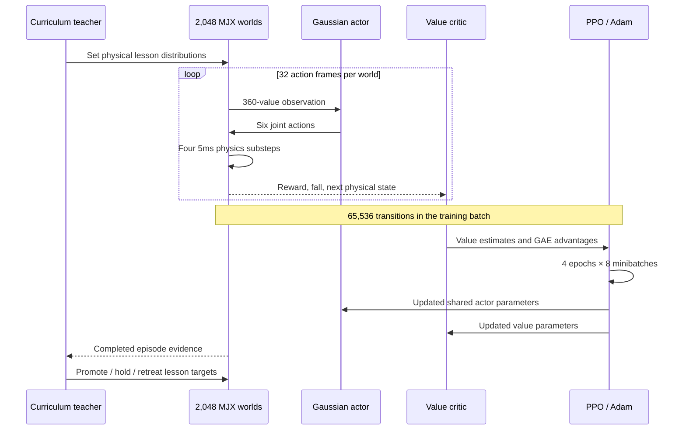

### Network and learning numbers

| Setting | Actual value |
| --- | --- |
| Actor MLP | **360 → 256 → 256 → 6** (tanh hidden layers) |
| Critic MLP | **360 → 256 → 256 → 1** (separate value network) |
| Actor distribution | Gaussian, six learned log-standard-deviations; action clipped to [−1, 1] for motors |
| Behavioural exploration std bounds | 0.10–0.60 |
| PPO rollout | 32 control frames × 2,048 worlds = **65,536 transitions** |
| Learning rate (base) | `2e-4`, with adaptive multiplier |
| Discount factor γ | **0.99** |
| GAE λ | **0.95** |
| PPO clipping ε | **0.20** |
| PPO passes | **4 epochs × 8 minibatches** |
| Minibatch size | **8,192 transitions** |
| Entropy coefficient | **0.002** |
| Value-loss coefficient | **0.5** |
| Value loss | Huber, δ = 10 |
| Gradient clipping | Separate global-norm limit 1.0 for policy and value groups |

The heart of PPO is its **clipped policy objective**. If a newly updated policy tries to make some old action vastly more or less likely, PPO limits how much that sample can drive the update:

\[
L_{\rm clipped}=\mathbb E\left[\min\left(r_t A_t,\operatorname{clip}(r_t,1-\epsilon,1+\epsilon)A_t\right)\right]
\]

Here `A_t` is the *advantage* (was the action better than expected?) and `r_t` is the new probability of that action divided by its old probability. We minimise negative clipped policy value plus value error, minus the exploration-entropy bonus.

**Why the engineering details matter:** the actor and critic have separate gradient clipping, so a sudden critic/value error doesn't smother the actor's useful correction. Non-finite updates are guarded; a soft KL-based learning-rate controller reduces overly aggressive updates, and a hard KL guard catches runaway updates. Falling actually ends an episode; simply reaching its time limit does **not** count as a fall, and value bootstrapping handles those endings differently.

**Not PPO's job:** PPO knows nothing about whether a slope should grow 0.3° or a teacher should assign more recovery cases. That belongs to the curriculum.

**Code:** [PPO implementation](emu/ppo.py) · [training doctrine](emu/training_config.py) · [orchestration](emu/training.py)

---

## 4. What counts as a good step? The actual reward

The actor is not rewarded merely for being upright. The core reward has **eight weighted parts**, inherited from the successful gait learner:

| Payment | Maximum nominal contribution per control frame | What it encourages |
| --- | ---: | --- |
| Alive | **0.58** | Stay in a valid episode |
| Locomotion | **1.55** | Really move, track the command and maintain body/foot quality |
| Posture | **0.68** | Keep a useful moving body attitude/height |
| Foot contact | **0.50** | Prefer feet rather than torso/leg collisions |
| Anti-slip | **0.18** | Avoid sliding feet along the ground |
| Swing clearance | **0.16** | Lift a foot meaningfully during a step |
| Smoothness | **0.12** | Avoid abrupt changes in servo action |
| Joint safety | **0.17** | Avoid joint-limit/scissoring pressure |

The maximums above describe the positive **component weights**; actual rewards are lower, combined with other physical shaping and penalties.

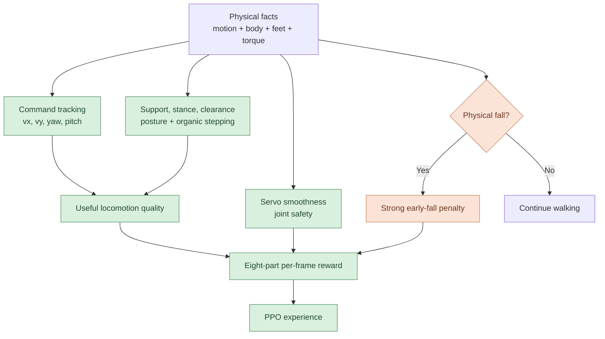

### There is no prescribed stepping animation

The model receives a **gait-phase reference** (sin/cos of phase) with a speed-responsive rate. It learns the actual feet/servo timing; the trainer rewards *emerging alternating foot activity* rather than commanding one leg to lift at a specified instant.

A motionless robot loses important locomotion and gait-activity credit. Resilience episodes allow **temporarily looser command tracking** while catching a disturbance—recovering balance can require a momentary deviation.

A true early fall incurs a substantial penalty: a base **65** plus **0.1 per control frame of remaining episode time**. The reward also contains experimental motor-effort/smoothness shaping in control-focused worlds. Its shaft-power estimates are only simulated mechanical proxies.

Step ascent has additional *one-time crossing and progressive approach* rewards. This is currently a weak part of the learner; see [What is not working yet](#9-what-isnt-working-yet).

**Code:** [eight main rewards](emu/rewards.py) · [real terrain/step evidence](emu/environment.py) · [reward reporting](emu/results.py)

---

## 5. Six specialists: parallel classrooms, **not six brains**

A useful mental model: 2,048 copies of the same robot attend different classes. The **teacher chooses the lesson**, but all students take their experiences back to **one shared set of neural weights**.

These are *focus allocations* rather than permanent physical identities: an environment receives its focus when an episode starts. A new episode may have a different focus.

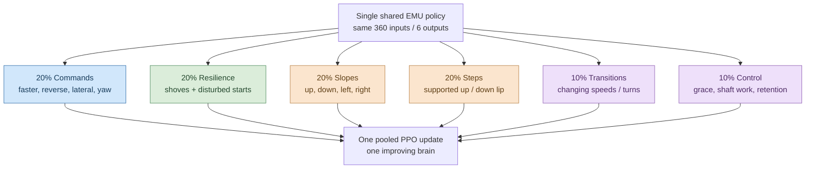

| Lesson focus | Real task | What success should mean | The current challenge |
| --- | --- | --- | --- |
| **Commands** | Forward/reverse speeds, ±sideways, ±yaw, mixtures | Tracking signed requested movement, not merely not falling | Edge evidence can be sparse; a growing requested frontier may outrun achieved speed |
| **Resilience** | Initial pose/velocity disturbance and horizontal torso pushes | Recover sustained supported movement and command tracking | Requested maximum shove is not force-conditioned proven recovery |
| **Slopes** | Real contact-plane grade in four bearings | Support **and** deliberate directional travel with low drift | Stable contact and accurate uphill tracking remain separate skills |
| **Steps** | Real upper/lower platform with a vertical lip | Supported far-side foot contact and actual traversal | Has struggled around millimetres; see diagnosis |
| **Transitions** | New commands, speed reversals, turn-rate changes | Timely acceleration/deceleration without tumbling | Must coexist with a fundamentally unstable gait |
| **Control / retention** | Easier moving missions, smooth motors and familiar commands | Efficient **useful** walking; preserve established skills | Needs a real no-regression check at fixed conditions |

### Two layers: *what* and *how hard*

The six focus labels are **one axis**. Each episode also inherits a **locomotion regime**:

- **Steady:** hold a movement request.
- **Transition:** cope with changes in speed or turning.
- **Resilience:** catch the robot after initial disturbances or externally applied pushes.

This separation is powerful, but was also a source of interference: the older terrain specialist might be given a slope or step **on top of** an unrelated transition/resilience regime.

The current coherent-terrain treatment makes focused STEP and SLOPE lessons steady, straight-ahead missions first. It still lets other worlds combine challenges, because ultimately real walking must work when the world is not neat.

### When do the specialists become active?

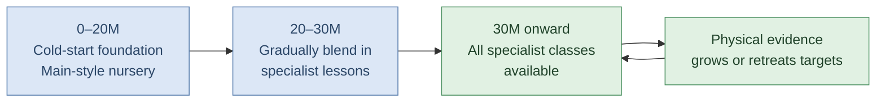

The first **70 PPO updates** also retain a steady-only bootstrap. The 20M boundary means *access to specialist lessons*, not that the policy has officially graduated into perfect walking. Individual frontiers are intended to advance from physical evidence rather than waiting for every other dimension to pass.

**Code:** [specialist schedules and roles](emu/capability_focus.py) · [episode assignment and real terrains](emu/environment.py)

---

## 6. The teacher: grow, hold or retreat (without confusing targets for talent)

The curriculum receives completed-episode data: fall rates, movement precision, episode length, supported step crossings, stability on actual inclines, and resilience outcomes.

It does **not** rewrite the policy. It adjusts the **next births' task distributions**.

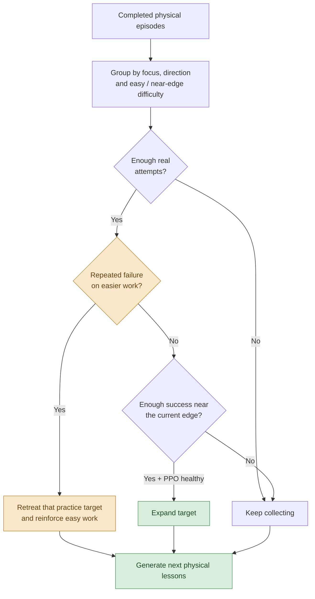

The current experimental teacher roughly requires:

| Target | Evidence for upward movement | Upward adjustment | Easier-task regression |
| --- | --- | --- | --- |
| Signed speed, sideways, yaw | Four completed near-edge episodes; ≥60% successful tracking (both signs for symmetric axes) | **×1.15** (+15%) | Typically ×0.88 |
| Slope grade | Four supported near-grade episodes **per each of four directions**; ≥65% stability | **+max(0.25°, 16%)** | Typically ×0.88 |
| Step height | Four real near-height attempts **up and down**; ≥55% supported completed success | **+max(1 mm, 18%)** | Typically ×0.82 |
| Push training frontier | Governed by resilience regime performance and fall evidence | **×1.08** when eligible | Stronger retreat on high falls |
| Mixed command region | Near-edge tracking evidence | ~10% expansion | Hold/retreat on failure |

These are **training-frontier heuristics**, not scientifically validated learning rates. Hard requests can fail without an immediate retreat; failing easier tasks can reduce the target. The ordinary regime/posture teacher also updates shared difficulty and allocates more practice toward struggling regimes.

**A vital limitation:** today there is no complete online, speed-by-force-by-terrain *certification map* protecting every previously mastered condition. The recovery-first design aims for that, but the v5026 implementation starts with **a fixed moving-rehearsal allocation and frozen-exam parent selection**, not a finished automatic no-forgetting guarantee.

### The three surfaces we ultimately want

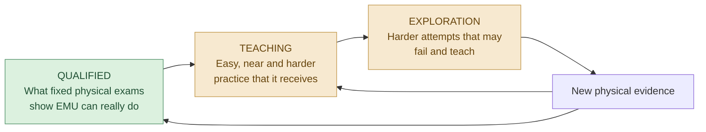

This is the **target architecture**. In the implementation, the teacher's adaptive practice frontiers and independent fixed examination are still more loosely coupled than the diagram might suggest. We keep that distinction explicit so a higher console number is never misreported as proven mastery.

**Code:** [governor and evidential gates](emu/curriculum.py) · [training summaries](emu/results.py) · [independent exams](emu/evaluation.py)

---

## 7. What changed in the recovery-first version?

The earlier 290M-step *aggregate* screening effort trained a common 50M actor plus twelve 20M forks (each finished at **70M individual age**, not 290M). It taught a foundation gait but struggled badly with mature speed and discontinuous terrain. The command and 4 N push requests expanded before there was enough independently demonstrated capability, while the real step practice repeatedly retreated.

The new **v5026 recovery-first** investigation restores more of the older successful learner's mature teaching *within* our single-policy split-environments design.

| Change | Earlier 360 experiment | New experimental option |
| --- | --- | --- |
| Mature ordinary +vx envelope | 0.40 m/s | **0.60 m/s** |
| Reverse / sideways / yaw envelope | −0.12 / ±0.14 / ±0.90 | **−0.20 / ±0.22 / ±1.50** |
| Speed-responsive gait-phase gain | 0.75 | **1.25** |
| Mature athletic rehearsal | 0% | **10%** |
| Common difficulty base step | 0.0014 | **0.0024** |
| Lifelong skills rehearsal | Normal control share, no dedicated retention treatment | **25% focused allocation** for deliberately moving familiar tasks |
| Step/slope teaching | Physical obstacle often layered over random task/regime | **Steady, deliberate crossing** option |
| Force exposure | Previous frontier could quickly reach 4 N | **Gentle ~0.7 N vs aggressive 4 N headroom** comparison |

These are **experiment knobs**, not a claim that the best recipe has already been proven. Also, the ordinary velocity envelope is not an absolute limit: specialist frontiers may request more than these values.

### Why protect easier abilities?

The owner's central hypothesis is that seeking speed may cause **catastrophic forgetting** of existing recovery skills. That is worth testing, but higher falls in newly harder training worlds alone are not proof of forgetting.

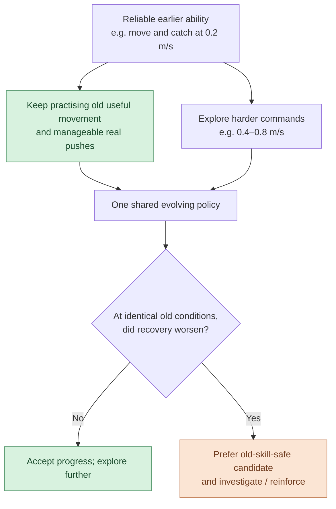

The **retention** group still walks: it receives forward and some reverse requests, modest lateral/yaw motion and manageable disturbances. It cannot earn a good result merely by standing rigidly still.

### Tonight's controlled campaign: 140M aggregate steps

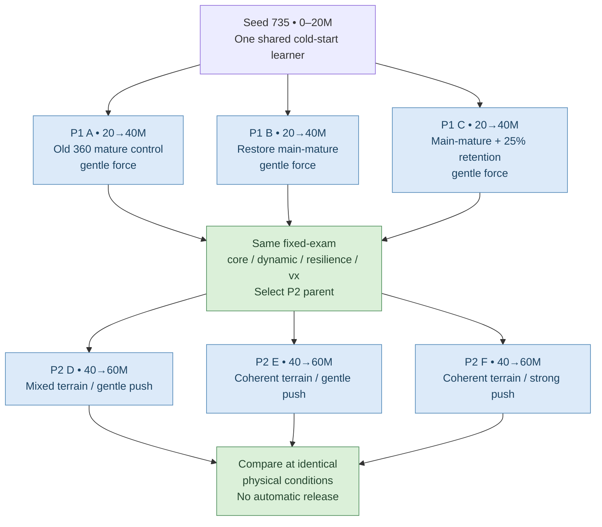

The launcher uses **source-pinned checkpoints**, preserving policy weights, value network, optimiser, normaliser and teacher state. It scores P1 candidates on the *same* frozen core/dynamic/recovery exams, with conservative regression checks. P2 compares **D vs E** for coherent terrain teaching and **E vs F** for force-interference effects.

**What this experiment does not yet do:** it does not independently run the old 232-input Pinnacle on the identical 360-input benchmark, prove a 4 N recovery region, or certify that a given recipe prevents forgetting at every speed. Those require dedicated physical matrices.

**Code:** [tonight's launcher](scripts/v5026_recovery_first.py) · [design and acceptance gates](docs/RECOVERY_FIRST_GROWTH.md) · [previous experiment analysis](docs/EXPERIMENT1_FINDINGS.md)

---

## 8. How to read EMU's console without fooling ourselves

For example, an excerpt like:

```text
step=29,229,056 rew=+3.201 len=700 fall=0.0%
vx=[-0.03,+0.16] act/cmd=+0.04/+0.05
slope=≤0.7°(11%) step≤0.2cm(15%) res=0.17
shaft≈117.6J/m up=1/3 down=3/3
```

| Display | What it means | What it **doesn't** mean |
| --- | --- | --- |
| `step` | Cumulative simulated environment transitions | Real robot footsteps |
| `rew` | Mean shaped PPO reward | A physical exam score |
| `len` | Mean episode length in control frames | Distance walked |
| `fall` | Falls in the current training rollout's challenge mix | Failure rate under fixed, comparable test conditions |
| `vx=[lo,hi]` | Current requested/practice **command frontiers** in m/s | Observed maximum achieved walking speed |
| `act/cmd` | Mean actual velocity / raw requested velocity | Boundary-speed tracking across all challenges |
| `slope=≤…°(…%)` | Slope practice target and exposure | Passed four-way grade exam |
| `step≤…cm(…%)` | Step-height practice target and exposure | Real supported crossing rate at that height |
| `res=…` | **Unitless resilience curriculum difficulty** | Newtowns of shove, or independently proven resilience |
| `shaft≈…J/m` | Mechanical work proxy per useful distance | Battery electrical energy |
| `up=x/y down=x/y` | Sampled supported-crossing evidence over a reporting window | Proof that all relevant step heights are mastered |
| `near(cmd+/-)` | Completed near-boundary directional evidence | Number of PPO updates |

**Especially important:** a log showing `vx=+0.32`, `res=0.29` and `step≤0.3cm` would indicate three different *training difficulty targets*. To claim EMU **walks** at 0.32 m/s, **recovers** a specified shove, or **crosses** a 3 mm ledge, use an actual, comparable frozen physical examination.

---

## 9. What isn't working yet?

### Steps are still the standout weakness

The present learner has shown progress in slow/growing commands and general resilience training, but meaningful real up/down steps remain unconvincing. In the recent study, the step practice target was around **0.3 cm (3 mm)**; that number does not establish that the policy passes 3 mm steps consistently.

A concrete, source-level limitation was found in the new coherent lesson path:

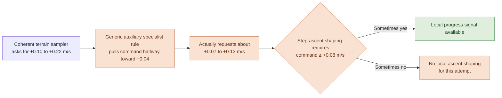

That reduction occurs because the **coherent terrain command** is subsequently processed by the generic non-command specialist adjustment:

\[
v_{\mathrm{effective}}=0.04+0.5\,(v_{\mathrm{sampled}}-0.04)
\]

It is a **real code-level inconsistency** between the teaching intention and the actual actor request. It's a plausible contributor to poor step-learning, not yet a verified single explanation. The rest of the task remains physically difficult: actual foothold selection, repeated supported traversal and post-cross survival are sparse outcomes compared with ordinary gait rewards.

**Do not edit a live source-pinned training checkout to fix this.** The next training revision should separately examine (a) operator command reaching the real task without unintended attenuation, (b) approach/clearance/support rewards at actual lip height, and (c) real exam pass rates at fixed step heights. This README is a documentation change only.

### Other open research questions

- Does restoring mature main-style training yield **real achieved speed**, rather than bigger teacher numbers?
- Does a fixed moving-rehearsal share protect **same-speed, same-force** recovery across policy ages?
- How well does the ToF ray array observe a lip ahead of the robot under realistic pitch, noise and foot occlusion?
- Does training with aggressive pushes harm acquisition of single-skill slope/step walking?
- When can efficiency improve without sacrificing supported movement or command accuracy?
- Can a 360-input policy reproduce and exceed the old 232-input Pinnacle on **identical, schema-correct physical tests**?

We report these as questions, not wins.

---

## 10. Running, inspecting and comparing EMU

### Install in WSL2 / Ubuntu

Requires Python 3.13, Git and a compatible Node runtime. NVIDIA/CUDA-enabled JAX is needed for GPU training; CPU viewing and documentation are separate.

```bash
git clone --single-branch --branch feature/v5024-release-polish \
  https://github.com/mdt733/emu.git "$HOME/emu-graduation"
cd "$HOME/emu-graduation"
bash scripts/setup_wsl.sh --cuda13 --install-node
source .venv/bin/activate
```

The script installs the Python environment and browser viewer; it does not begin training. To inspect the research plan **without starting the GPU**:

```bash
python scripts/v5026_recovery_first.py
```

To launch the recovery-first study, **in a clean checkout and outside an existing run**:

```bash
python -u scripts/v5026_recovery_first.py --run
```

- **Foreground console**, no tmux.
- 20M shared cold start, three P1 forks, then three P2 forks = **140M aggregate environment steps**.
- Exact source SHA is recorded; CPU smoke and a full **2,048-world CUDA update** happen before training begins.
- Checkpoints, candidate-selection decisions, metrics, reports and logs live outside Git in `~/robot_lab/emu_runs/v5026_recovery_first_s735/`.
- A matching source/run can resume. **Do not `git pull` into a checkout that is already running a source-pinned experiment**; use another checkout for browsing or editing docs.
- Report bundle: `overnight_results.zip` under the campaign root.

### Read-only physical examination

```bash
# Export a compatible saved policy with the exact-source checkout.
emu export-policy /path/to/checkpoints/final.pkl /path/to/candidate.emupolicy

# Independently examine the 360-input policy.
emu capability-exam --terrain-matrix \
  --policy /path/to/candidate.emupolicy \
  --output "$HOME/robot_lab/emu_runs/candidate_physical_exam" \
  --device cpu --worlds 8 --horizon 350
```

The terrain examiner measures real collision outcomes including up/down supported crossings, grades in four directions, commanded movement, drift, stability and recovery. The historical 232-input Pinnacle needs its **own legitimate observation pipeline**; simply loading it as a 360 actor would be an invalid comparison.

### Watch the robot

```bash
emu viewer showcase/champion.emupolicy --no-open
# Open http://127.0.0.1:8765/
```

The browser viewer supports a readable visual course, movable commands and physical terrain. It is a useful **qualitative demonstration**, not a substitute for frozen, matched physical exams. The local server is not authenticated; do not expose the port publicly.

[Full installation and exam guidance](docs/INSTALL.md) · [Public EMU playground](https://mdt733.github.io/emu/)

---

## 11. A map of the codebase

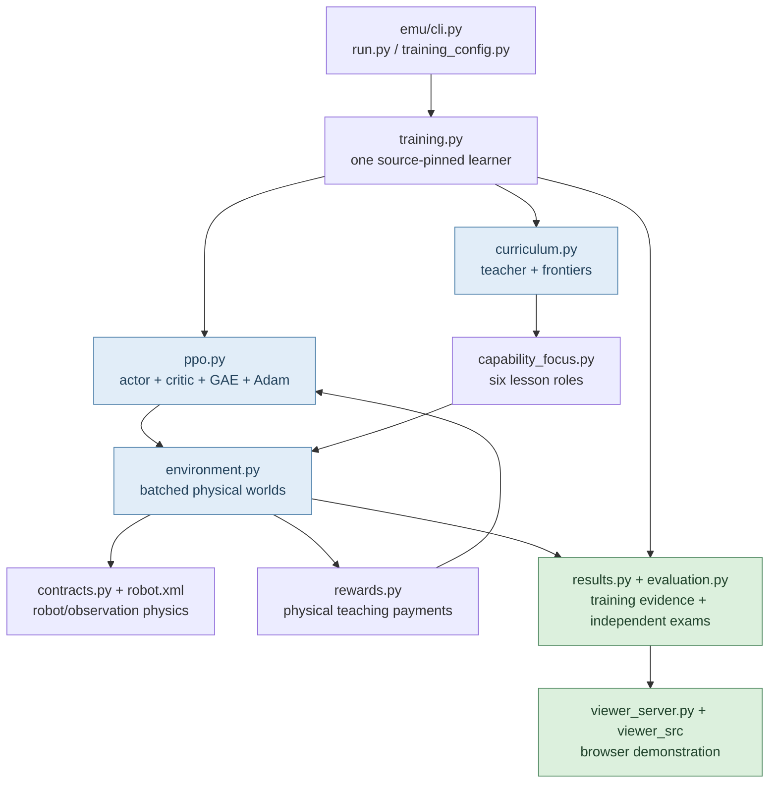

| File / area | Responsibilities |
| --- | --- |
| [`emu/robot.xml`](emu/robot.xml) | Robot dimensions, actuator definitions, inertial/elastic and contact model |
| [`emu/contracts.py`](emu/contracts.py) | Exact observation shapes, control clocks, sensor contracts and JAX teacher packet names |
| [`emu/environment.py`](emu/environment.py) | Batched MJX stepping, actuator delay, sensor synthesis, real slopes/steps/pushes, episodes and raw measurements |
| [`emu/rewards.py`](emu/rewards.py) | The eight primary walking payments, fall penalty and optional control/motor costs |
| [`emu/ppo.py`](emu/ppo.py) | Actor/critic MLPs, Gaussian sampling, rollout, GAE, clipped PPO, optimiser and read-only rollout inference |
| [`emu/training.py`](emu/training.py) | Update loop, training-health safeguards, checkpoints, fixed exams and teacher feedback |
| [`emu/curriculum.py`](emu/curriculum.py) | Regime difficulty and real completed-evidence growth/retreat decisions |
| [`emu/capability_focus.py`](emu/capability_focus.py) | Six role weights, cold-start-to-specialist blend, independent command sampling |
| [`emu/training_config.py`](emu/training_config.py) + [`emu/run.py`](emu/run.py) | Auditable training profiles, source and checkpoint-compatibility guards |
| [`emu/evaluation.py`](emu/evaluation.py) + [`emu/results.py`](emu/results.py) | Fixed/held-out exams, summary telemetry and research report bundles |
| [`scripts/v5026_recovery_first.py`](scripts/v5026_recovery_first.py) | Foreground, sequential P1/P2 experiment with conservative parent selection |
| [`emu/viewer_src/`](emu/viewer_src/) | Browser visualisation and interactive policy replay |

### Reproducibility and project status

The published [Pinnacle playground](https://mdt733.github.io/emu/) is the protected **260M-step / 232-input reference policy**. Current research candidates use a different **360-input** interface and have not yet established superiority in a matched real-physics exam. The aggregate world-step count of a tournament must not be confused with the training age of any one actor.

Development belongs on **feature branches only**. Checkpoints and GPU runs are pinned to the exact source and training configuration. A new README or training change is **not** permission to change a running checkout, overwrite saved policies, merge into `main` or replace the public champion.

For the evolving engineering story:

- [Why the earlier 290M experiment underdelivered](docs/MAIN_VS_V5025_ROOT_CAUSES.md)
- [Experiment 1: audited results](docs/EXPERIMENT1_FINDINGS.md)
- [Recovery-first research and acceptance plan](docs/RECOVERY_FIRST_GROWTH.md)
- [Physical capability dimensions](docs/CAPABILITY_DIMENSIONS.md)
- [Release and promotion checklist](docs/RELEASE_READINESS.md)
- [Living handover](HANDOVER.md)

---

<details>
<summary><strong>Glossary — the terms we use in every training report</strong></summary>

**Actor:** the network that chooses six servo actions. **Critic:** a second network estimating future reward, used only for training. **World:** an independent batched MJX simulation of EMU. **Episode:** one attempted stretch of walking, ending on physical failure or timeout. **Rollout:** 32 consecutive control frames of experience across all 2,048 worlds. **Regime:** the ordinary steady, transition or resilience type of movement. **Focus:** the specialist teacher emphasis, e.g. steps or commands. **Frontier:** current training target; it is not independently certified performance. **Near-edge attempt:** a completed physically graded task close to its current frontier. **PPO:** a bounded policy-gradient update using freshly collected experience. **GAE:** an estimator of how much better an action was than the critic expected. **Resilience difficulty:** a unitless teacher dial, *not* applied shove force. **Supported crossing:** a verified physical arrival beyond a discontinuity with foot contact. **J/m:** simulated mechanical shaft-work proxy per useful metre, not electrical watt-hours.

</details>

*EMU aims for a little robot that steps, catches itself, travels where it was asked, adapts to the ground ahead—and keeps doing the things it already learned while discovering new ones.*
