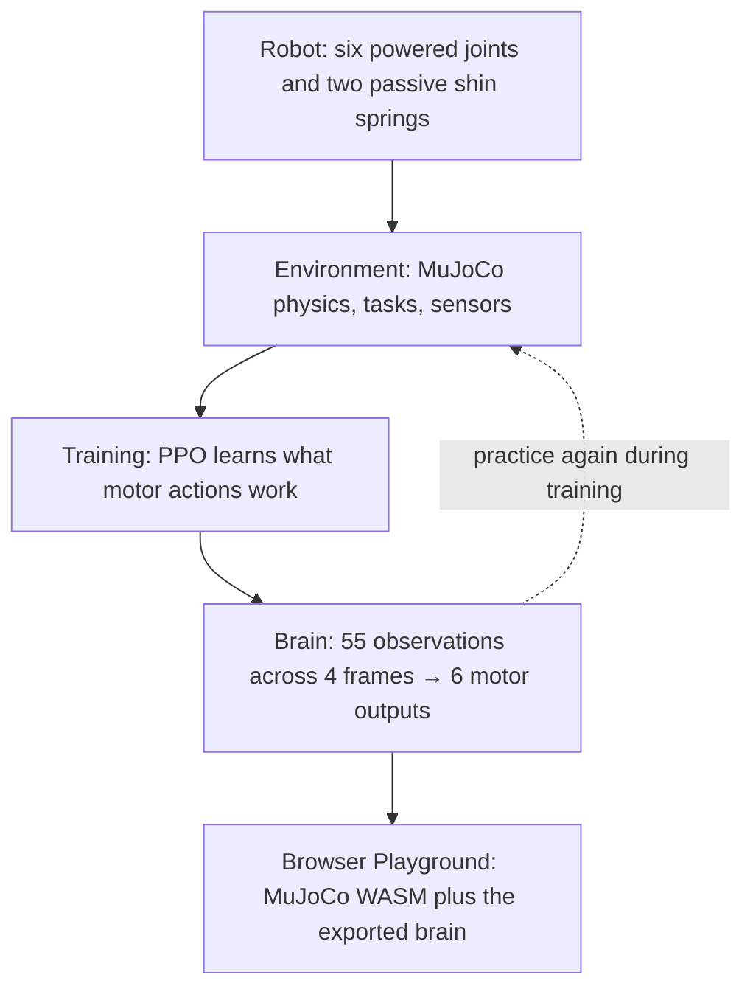

# EMU — a little robot learning to walk

**Six motors. Two feet. No prewritten walking animation.** EMU is an open-source biped learning to step, steer, catch itself and recover balance in simulated physics.

## [▶ Try the EMU Playground](https://mdt733.github.io/emu/)

**[Open the live browser demo](https://mdt733.github.io/emu/)** · [Source code](https://github.com/mdt733/emu) · [How it works](docs/architecture.md)

The Playground runs a published **60-million-step policy** in your browser. Move using the left joystick, turn and command chassis pitch with the right, or let the demo select commands. The new **View** button cycles orbit view, raw chassis POV, and visually levelled POV.

> This is a learning experiment, not an animation or a finished physical robot. The public demo is not a held-out scientific evaluation. The current experimental training runs independently; it cannot replace the protected public policy automatically.

## How it works



The robot receives movement and posture requests. It senses gravity-relative orientation, motion, joints and foot locations, then chooses six motor targets 50 times per second. Training shapes its neural network through simulated experience; **the exported browser brain does not keep learning**.

**Two important angles:** *Robot lean* describes the line from the midpoint between the feet to the centre of the chassis relative to vertical; *chassis pitch* describes the actual body/IMU angle relative to gravity. They are different. [See the definitions and explanation](docs/architecture.md#robot-lean-vs-chassis-pitch).

### Explore the world

Orbit view makes gait easy to watch. **Raw POV** follows the chassis camera, shake included. **Level POV** smooths the picture without helping the robot balance. The optional **physical 1° ramp** under Settings adds real MuJoCo collision geometry in the *browser only*: unlike the flat-floor baseline, it is an experimental obstacle, **not yet a verified champion capability**. [Playground guide](docs/PLAYGROUND.md).

## The code, without the mystery

| Part | Start with | Purpose |
|---|---|---|
| Robot | [`emu/robot.xml`](emu/robot.xml) | Body, masses, joints, motors and contacts |
| Environment | [`emu/environment.py`](emu/environment.py) | Physics tasks, observations, reward and resets |
| Today's ladder | [`emu/ladder_recipe.py`](emu/ladder_recipe.py) | The current list of steps, hypotheses and screening conditions |
| Experiment runner | [`emu/branch_lab.py`](emu/branch_lab.py) | Checkpoint/resume safety, held-out comparison and promotion |
| Training engine | [`emu/training.py`](emu/training.py) | PPO learning loop driven by a serialized configuration |
| Brain | [`emu/ppo.py`](emu/ppo.py) | Neural actor/critic and optimiser |
| Viewer | [`viewer/`](viewer/) | Canonical JavaScript source for MuJoCo WASM, controls and cameras |

The other Python modules handle curriculum, domain randomisation, checkpoint safety and evidence. Tests and selected results are intentional, not clutter. `emu/viewer_src/` remains a **generated packaging mirror**, not a second editable viewer. Large training runs and raw checkpoints live outside Git.

## The commands you actually need

```bash
emu ladder --stage plan        # inspect current experiment, no training
bash scripts/run_ladder.sh     # validate GPU then execute current ladder
emu viewer --live              # separate read-only live checkpoint viewer
```

The **editable recipe is in one small file:** [`emu/ladder_recipe.py`](emu/ladder_recipe.py). Each experiment arm supplies typed, validated **`TrainingConfig` knob overrides**; the ladder runner calls the stable training engine. The old `forge`/`tournament`/`train`/`compare` runners have been removed from current code, but remain available in **Git history** for research reproduction. `lab5015` remains as a command alias for older shell scripts.

## Current training: v5015 research ladder

The public 60M champion is protected and is **not replaced by training**. The current learning experiment probes four hypotheses using a shared 20M beginner brain, 26M first-round forks, 34M finalists and a 46M continuation. This spends roughly **72M aggregate environment steps**, including none of the extra long-horizon steps needed to investigate the previous 100–200M crouching failure.

The user confirmed a v5015 GPU/MJX/PPO optimiser smoke test. They subsequently reported that the first ladder **failed during training**, but the console error has not yet been provided. Its cause is unknown; don't interpret the incomplete run as a negative experiment result.

```bash
emu ladder --stage plan                   # the experiment; no GPU training
bash scripts/run_ladder.sh                # run a new campaign after validation
bash scripts/run_ladder.sh --stop-after round1
emu posture-report --root ~/robot_lab/emu_runs/v5015_lab1
```

Every branch inherits complete learning state, uses an independently stored training config and checkpoint, and is screened against the same held-out tasks. Strong early scores are **not** proof of long-term robustness or physical-hardware transfer. [Experiment details](docs/tournament.md).

## Running EMU yourself

For a fresh Linux/WSL2 checkout you need Python 3.13, Git and Node.js 24. GPU training requires compatible NVIDIA/JAX CUDA support.

```bash
bash scripts/setup_wsl.sh --cuda13 --install-node  # omit --cuda13 for CPU-only work
source .venv/bin/activate
emu doctor --domain-smoke
emu ladder --stage plan  # inspect current experiment, no training
```

`emu viewer --live --no-open` starts a separate read-only **local** checkpoint viewer at http://127.0.0.1:8765/. The public Playground is static and never accesses your private training run.

**Details when you're ready:** [Install](docs/INSTALL.md) · [Architecture](docs/architecture.md) · [Training](docs/training.md) · [Evaluation](docs/evaluation.md) · [Document index](docs/README.md) · [History](docs/history.md) · [Current handover](HANDOVER.md) · [Validation evidence](RELEASE_VALIDATION.md).
