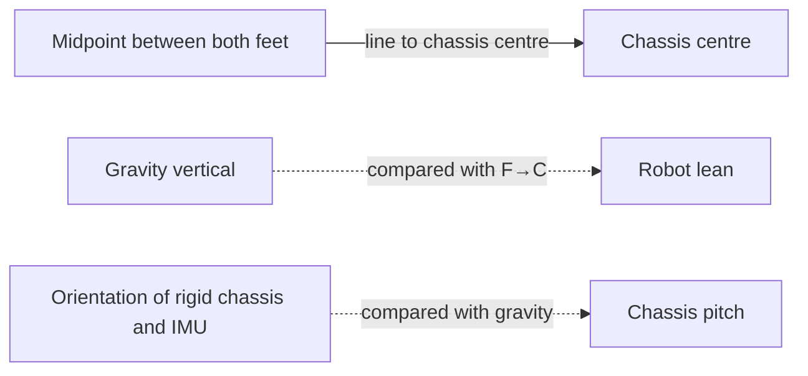

# EMU architecture — ownership and trust boundaries

The project separates components because they answer different questions; changes should flow through explicit contracts rather than cross-module mutation.

| Component / owner | Responsibility |
|---|---|
| `emu/environment.py` | MuJoCo/MJX physics, task packets, resets, rewards, termination and deployable observations |
| `emu/ppo.py` | Actor/critic, observation normalisation, PPO rollout and update |
| `emu/curriculum.py` | Legal difficulty/frontiers and retreat/advance policy |
| `emu/health.py` | PPO health, collapse detection, learning-rate stress and mature rollback recommendations |
| `emu/capability_field.py` | Semantic node, maneuver-edge and recovery evidence; bounded teaching proposals |
| `emu/evaluation.py`, `emu/capability_cloud.py`, `emu/atlas.py` | Read-only fixed tests, calibration and physical frontiers |
| `emu/training.py` | Composes the update loop and own-run artifacts; never lets held-out evaluators train the field |
| `emu/ladder_recipe.py` | **Current human-readable experiment recipe**: stages, arms, step boundaries and common screening target |
| `emu/branch_lab.py` | Current ladder runner, checkpoint inheritance, comparisons and promotion |
| `emu/run_support.py` | Validated checkpoint handoff, source provenance and subprocess launch of the stable trainer |
| `emu/phase_config.py` | Pure foundation/mature presets and strict same-path resume contract |
| `emu/training_config.py` | Strongly typed training knobs, explicit experiment overrides and frozen algorithm doctrine |
| `emu/domain_randomization.py` | Batched JAX-valued robot/terrain/hardware model variation per training world |
| `emu/contracts.py`, `emu/tracking_contract.py` | Shared deployable 55×4 observation, six action targets, task packet and physical event thresholds |
| `emu/checkpoint_io.py`, `emu/checkpoints.py` | Validated schema-7 checkpoint save/read, atomic replacement and finite-policy protection |
| `emu/policy_export.py` | Actor-only JSON `.emupolicy` export; excludes critic/optimizer and held-out training state |
| `emu/live_viewer.py`, `emu/viewer_server.py` | Loopback-only, CPU/read-only validated checkpoint feed and viewer build/server |
| `emu/viewer_src/` | Canonical MuJoCo WebAssembly + Three.js UI, local inference, manual/demo input and static showcase |
| `scripts/prepare_showcase.py` | Packages a static manifest and policy for browser-only hosting, without training or Python API |

## Important invariants

The **capability field** proposes *where* to practise; the **curriculum/governor** decides *what is currently permitted*; the **domain randomiser** samples *what physical conditions exist*. The **held-out examiner** never updates any of these. `emu/training_config.py` holds the narrow varying experiment surface and fixed doctrine; derived reporting-only state should not be duplicated in checkpoints.

The actor sees only the canonical **220-number** history vector; the inference actor is 220→256→256→6 with tanh hidden layers. `.emupolicy` is not a trainer resume file: only schema-7 `.pkl` checkpoints can continue PPO. See [hardware-model.md](hardware-model.md), [capability-map.md](capability-map.md) and [viewer/POLICY_FORMAT.md](../emu/viewer_src/POLICY_FORMAT.md).

## Process boundaries

The trainer owns CUDA/JAX and writes under `../emu_runs/`. The local `emu viewer --live` is a **separate read-only CPU watcher** serving only on `127.0.0.1:8765`; browser JavaScript runs inference and nominal MuJoCo dynamics. GitHub Pages publishes a **different static bundle**, and has no private training API. The viewer demonstration is not an evaluator.

**Single responsibility:** `emu/ladder_recipe.py` declares *what to test*. `emu/branch_lab.py` handles *when and who advances*. `emu/run_support.py` handles *validated checkpoints and launching*. `emu/training.py` handles *how learning works*, consuming the typed `TrainingConfig`. Per-arm overrides are validated against declared config field types and cannot rewrite run identity, source profile, or checkpoint destinations.

Old `forge`, `forge5015`, `train`, `compare` and `tournament` source was retired rather than left available as competing current CLIs. The exact original code remains in Git history at main commit `b0f31d8`, along with experiment data and historical rationale. To reproduce it, use a **separate** historical checkout, never the current training run root. The `lab5015` alias remains solely for script compatibility.

## Robot lean vs chassis pitch

These are two different geometric measurements; they must not be conflated by the next generation of reward functions.

**Robot lean** is the angle between the foot-midpoint-to-chassis-centre line and gravity-vertical. The viewer displays **signed forward lean** by projecting horizontal displacement into the robot's heading and calculating `atan2(forward displacement, vertical separation)`. Positive means the chassis centre is ahead of the feet midpoint in the facing direction. This is a geometric diagnostic, **not** a contact-aware support-polygon or centre-of-mass calculation; it averages *both* feet even when a foot is airborne.

**Chassis pitch** is the rigid torso/IMU's actual gravity-relative pitch. The training metric currently calls this `body_pitch`; the viewer now labels it `chassis pitch`. It uses `atan2(projected_gravity_x, -projected_gravity_z)`. A chassis can point 45° while robot lean is near zero if the legs keep its centre above the feet, or robot lean can be large while the chassis remains level.

**A slider range is not proof of physical capability.** The v5015 ladder includes a 15° pitch-ceiling hypothesis, but held-out chassis tracking at wide angles remains to be demonstrated. Older small-angle assumptions, posture rewards and the upright competence threshold in `tracking_contract.py` (20°) still need scrutiny before treating ±45° as reliable. Robot lean and commanded chassis pitch must be evaluated separately; this does not change the 220-observation/six-action actor interface.

## Why a browser ramp differs from MJX training slopes

The current MJX environment uses gravity-equivalent slope perturbations against a **flat collision plane**, retaining the same collision topology across vectorised worlds. In v5015 the `slope` experiment arm trains with a small terrain radius (`0.12`); the common held-out screen uses a separate fixed radius (`0.20`). These numbers specify distribution strength, not proof that any policy can negotiate a physical incline.

The viewer's optional **1° up/flat/down collision course** is real geometry, including discontinuities between sections. Training on tilted gravity alone does not establish competent foot placement on those transitions. The old standalone morphology/heightfield generators were never connected to training and have been retired from the active package; their prototypes remain available in Git history.

## Evaluation and checkpoint identity

A fixed test is scored against the *post-update actor* and its corresponding observation normaliser, bound as a `PolicySnapshot`. That score may differ from rollout rewards at the same logged step because the rollout was generated by the **previous policy**. The trainer promotes `best.pkl` on the actor's own fixed score (not a rolling average of different policies) and writes `latest.pkl`, `recovery.pkl` and `final.pkl` for distinct purposes.

Run-state checkpoints restore learning state, not the simulator's in-progress physical episode. The Python-vs-browser inference parity test checks actor computation and float32 encoding; it does not establish that MJX and WASM produce identical sensor readings or contact dynamics.

[Training](training.md) · [Evaluation](evaluation.md) · [Validation](validation.md)
