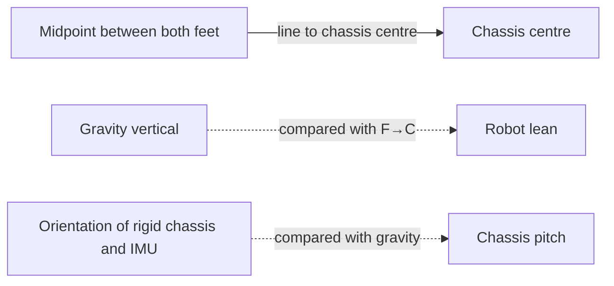

# EMU architecture — ownership and trust boundaries

The project separates components because they answer different questions; changes should flow through explicit contracts rather than cross-module mutation.

| Component / owner | Responsibility |
|---|---|
| `emu/environment.py` | MuJoCo/MJX physics, task packets, resets, rewards, termination and deployable observations |
| `emu/ppo.py` | Actor/critic, observation normalisation, PPO rollout and update |
| `emu/curriculum.py` | Legal difficulty/frontiers and retreat/advance policy |
| `emu/health.py` | PPO health, collapse detection, learning-rate stress and mature rollback recommendations |
| `emu/capability_field.py` | Semantic node, maneuver-edge and recovery evidence; bounded teaching proposals |
| `emu/evaluation.py`, `emu/capability_cloud.py`, `emu/atlas.py` | Read-only fixed tests, calibration and physical frontiers |
| `emu/training.py` | Composes the update loop and own-run artifacts; never lets held-out evaluators train the field |
| `emu/ladder_recipe.py` | **Current human-readable experiment recipe**: stages, arms, step boundaries and common screening target |
| `emu/branch_lab.py` | Current ladder runner, checkpoint inheritance, comparisons and promotion |
| `emu/experiments.py` | Shared checkpoint/resume and training helpers used by current and historical recipes |
| `emu/phase_config.py` | Shared phase configuration and strict restart compatibility, used by current/historic runners |
| `emu/production.py` | Historical single-lineage v5014 and v5015 forge recipes only (now detached from active ladder) |
| `emu/tournament.py` | Reproducible historical v5013 successive-halving experiment |
| `emu/domain_randomization.py` | Batched JAX-valued robot/terrain/hardware model variation per training world |
| `emu/contracts.py`, `emu/tracking_contract.py` | Shared deployable 55×4 observation, six action targets, task packet and physical event thresholds |
| `emu/checkpoint_io.py`, `emu/checkpoints.py` | Validated schema-7 checkpoint save/read, atomic replacement and finite-policy protection |
| `emu/policy_export.py` | Actor-only JSON `.emupolicy` export; excludes critic/optimizer and held-out training state |
| `emu/live_viewer.py`, `emu/viewer_server.py` | Loopback-only, CPU/read-only validated checkpoint feed and viewer build/server |
| `viewer/` | Canonical MuJoCo WebAssembly + Three.js UI, local inference, manual/demo input and static showcase |
| `scripts/prepare_showcase.py` | Packages a static manifest and policy for browser-only hosting, without training or Python API |

## Important invariants

The **capability field** proposes *where* to practise; the **curriculum/governor** decides *what is currently permitted*; the **domain randomiser** samples *what physical conditions exist*. The **held-out examiner** never updates any of these. `emu/training_config.py` holds the narrow varying experiment surface and fixed doctrine; derived reporting-only state should not be duplicated in checkpoints.

The actor sees only the canonical **220-number** history vector; the inference actor is 220→256→256→6 with tanh hidden layers. `.emupolicy` is not a trainer resume file: only schema-7 `.pkl` checkpoints can continue PPO. See [hardware-model.md](hardware-model.md), [capability-map.md](capability-map.md) and [viewer/POLICY_FORMAT.md](../viewer/POLICY_FORMAT.md).

## Process boundaries

The trainer owns CUDA/JAX and writes under `../emu_runs/`. The local `emu viewer --live` is a **separate read-only CPU watcher** serving only on `127.0.0.1:8765`; browser JavaScript runs inference and nominal MuJoCo dynamics. GitHub Pages publishes a **different static bundle**, and has no private training API. The viewer demonstration is not an evaluator.

`emu ladder --stage plan` is the recommended human interface; `bash scripts/run_ladder.sh` performs version/GPU checks before training. The `lab5015` spelling stays as a compatibility alias. Older `train`, `compare`, `tournament`, `forge` and `forge5015` commands remain available for historical reproduction, not as competing current workflows.

**Removal caution:** today's ladder now calls the shared `_phase_config` and `verify_existing_phase_config` in `phase_config.py`, rather than the historic `production.py`. The former module re-exports the helpers to preserve old test/import compatibility. The ladder also uses checkpoint and subprocess helpers in `experiments.py`, so that module is **not** obsolete. Keep historical forge available until old runs are no longer needed; remove the public alias separately from deleting archives.

## Robot lean vs chassis pitch

These are two different geometric measurements; they must not be conflated by the next generation of reward functions.

**Robot lean** is the angle between the foot-midpoint-to-chassis-centre line and gravity-vertical. The viewer displays **signed forward lean** by projecting horizontal displacement into the robot's heading and calculating `atan2(forward displacement, vertical separation)`. Positive means the chassis centre is ahead of the feet midpoint in the facing direction. This is a geometric diagnostic, **not** a contact-aware support-polygon or centre-of-mass calculation; it averages *both* feet even when a foot is airborne.

**Chassis pitch** is the rigid torso/IMU's actual gravity-relative pitch. The training metric currently calls this `body_pitch`; the viewer now labels it `chassis pitch`. It uses `atan2(projected_gravity_x, -projected_gravity_z)`. A chassis can point 45° while robot lean is near zero if the legs keep its centre above the feet, or robot lean can be large while the chassis remains level.

**Do not simply expand the pitch slider to ±45°.** Current v5014 rewards, torso-relative velocity tracking, posture limits and the competence check in `tracking_contract.py` (20° upright threshold) were written for small chassis commands. This viewer-only pass does not change the 220-observation/six-action actor interface or claim 45° training. Separating the robot's support geometry from the chassis's requested attitude is an explicit future training task.

## Why a browser ramp differs from MJX training slopes

In the production GPU path, varying gravity against a flat collision plane is equivalent to a robot on an infinite inclined plane while keeping MJX topology fixed. Its terrain severity radius grows from `T=0.08` near 60M to `T=0.70` near 400M, with a cap of ±6° multiplied by that radius per slope axis: approximately ±0.48° and ±4.2° at these phase targets. Actual samples are typically milder.

The optional viewer-only **1° up/flat/down course** uses physical collision boxes, so the robot experiences height changes and transitions not present in infinite-plane training. Its success is unverified. Neither the terrain switch nor the three camera modes modifies training physics, saved weights, or the policy observation contract. The experimental 33×33 heightfield generator in `emu/terrain.py` is **not part of default forge training**.
